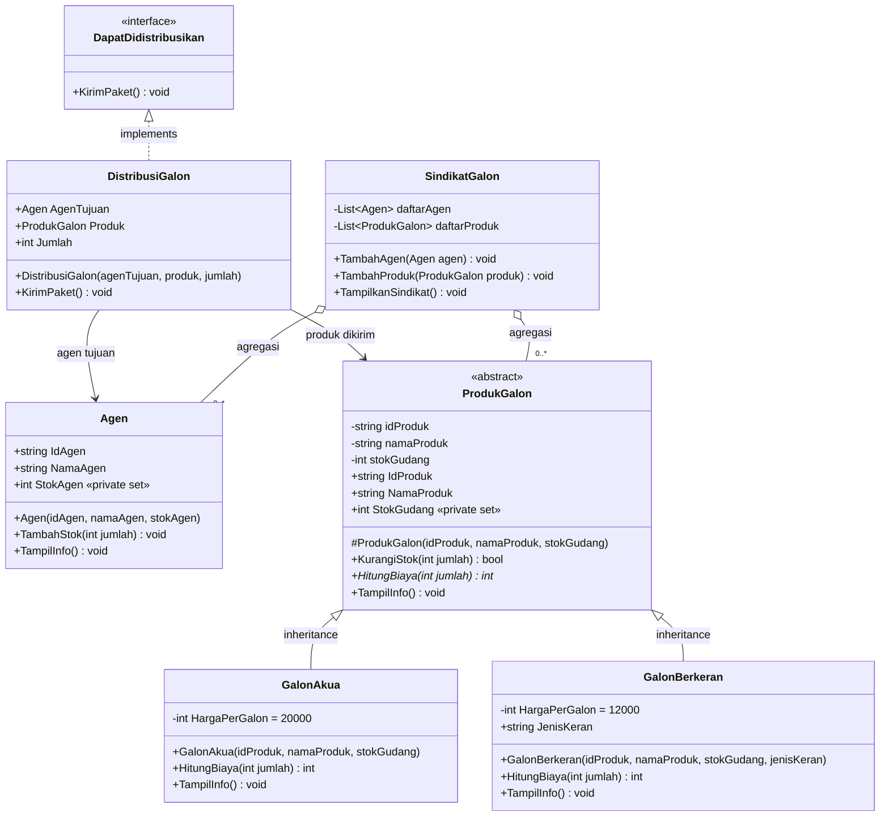

# C_3068_AlthaLinggaLeksono_B_remedi


# Laporan UTS Pemrograman Berorientasi Objek – Tipe B

**Studi Kasus: Sistem Manajemen Distribusi "Mafia Galon"**

| | |
|---|---|
| **Nama** | Altha Lingga Leksono |
| **NIM** | 252410103068 |
| **Kelas** | C |
| **Tipe Soal** | B |
| **Bahasa** | C# (.NET Console App) |

---

## Daftar Isi

1. [Deskripsi Program](#deskripsi-program)
2. [Class Diagram](#class-diagram)
3. [Penjelasan Kode per Soal](#penjelasan-kode-per-soal)
4. [Hubungan Antar Class](#hubungan-antar-class)
5. [Alur Program di Main](#alur-program-di-main)
6. [Cara Menjalankan](#cara-menjalankan)

---

## Deskripsi Program

Program ini adalah aplikasi konsol berbasis objek untuk mengelola distribusi air galon milik sindikat "Mafia Galon" di Kota Metropolis. Sistem mencatat data agen, mengelola dua jenis produk galon (Galon Akua dan Galon Berkeran), menghitung biaya transaksi, serta memvalidasi setiap pengiriman agar stok gudang dan stok agen selalu konsisten.

Seluruh kode berada di satu file `Program.cs` dalam namespace `MAFIAGALON`.

---

## Class Diagram



**Keterangan simbol:**

| Simbol | Arti |
|---|---|
| `+` | public |
| `-` | private |
| `#` | protected |
| `*` (di akhir method) | abstract method |
| `<\|--` | inheritance (pewarisan) |
| `<\|..` | implementasi interface |
| `-->` | asosiasi |
| `o--` | agregasi |

---

## Penjelasan Kode per Soal

### 1. Class, Object, Attribute, dan Method

Class `Agen` merepresentasikan markas/cabang agen di bawah sindikat.

- **Atribut:** `IdAgen`, `NamaAgen`, dan `StokAgen`. `StokAgen` memakai `private set` sehingga hanya bisa diubah dari dalam class.
- **Method:**
  - `TampilInfo()` menampilkan informasi agen ke konsol.
  - `TambahStok(int jumlah)` menambah stok agen. Method ini dipakai oleh `DistribusiGalon` saat pengiriman berhasil, dan hanya memproses jumlah lebih dari 0.
- **Object:** di `Main` dibuat dua objek dengan data berbeda, yaitu `agen1` ("Markas Lalad") dan `agen2` ("Markas Neil").

```csharp
Agen agen1 = new Agen("AG01", "Markas Lalad", 10);
Agen agen2 = new Agen("AG02", "Markas Neil", 5);
```

### 2. Encapsulation

Class `ProdukGalon` menyimpan atribut dengan akses `private`:

- `idProduk`, `namaProduk`, `stokGudang`

Akses ke atribut dilakukan melalui **properties** `IdProduk`, `NamaProduk`, dan `StokGudang`.

Dua aturan stok diterapkan:

1. **Stok tidak boleh negatif.** Setter `StokGudang` memeriksa nilai yang masuk. Jika negatif, stok diset menjadi 0 dan muncul pesan peringatan.
2. **Stok hanya bisa dikurangi lewat `KurangiStok(int jumlah)`.** Setter `StokGudang` bersifat `private`, jadi kode di luar class tidak bisa mengubah stok secara langsung.

`KurangiStok` mengembalikan `bool`:

- `false` jika `jumlah <= 0` atau `jumlah > stokGudang`
- `true` jika stok berhasil dikurangi

```csharp
public bool KurangiStok(int jumlah)
{
    if (jumlah <= 0) return false;
    if (jumlah > stokGudang) return false;
    stokGudang -= jumlah;
    return true;
}
```

### 3. Inheritance

Dua class turunan mewarisi `ProdukGalon`:

| Class | Harga per galon | Atribut tambahan |
|---|---|---|
| `GalonAkua` | Rp20.000 | – |
| `GalonBerkeran` | Rp12.000 | `JenisKeran` (string) |

Harga disimpan sebagai konstanta `private const int HargaPerGalon` karena nilainya tetap. Kedua class memanggil constructor induk dengan `: base(idProduk, namaProduk, stokGudang)`, sehingga seluruh atribut dan method `ProdukGalon` ikut diwariskan. `GalonBerkeran` menambahkan atribut `JenisKeran` karena jenis galon ini memiliki keran yang berbeda-beda.

### 4. Polymorphism

Method `HitungBiaya(int jumlah)` di-*override* pada kedua class turunan:

| Class | Rumus |
|---|---|
| `GalonAkua` | `jumlah × 20.000` |
| `GalonBerkeran` | `jumlah × 12.000` |

Method `TampilInfo()` juga di-*override* agar setiap jenis galon menampilkan harga dan jenisnya sendiri.

Penerapan polymorphism di `Main` memakai array bertipe `ProdukGalon` yang berisi objek `GalonAkua` dan `GalonBerkeran`. Saat `HitungBiaya` dipanggil, method yang dijalankan menyesuaikan objek aslinya secara dinamis (*dynamic dispatch*).

```csharp
ProdukGalon[] daftarProduk = { akua, berkeran };
foreach (ProdukGalon produk in daftarProduk)
{
    Console.WriteLine($"Biaya 3 galon {produk.NamaProduk}: Rp{produk.HitungBiaya(3):N0}");
}
```

### 5. Abstract Class

`ProdukGalon` dideklarasikan sebagai `abstract class`, sehingga tidak dapat diinstansiasi secara langsung. Penulisan `new ProdukGalon(...)` akan menghasilkan error saat kompilasi. Constructor-nya dibuat `protected` agar hanya dapat dipanggil oleh class turunan.

`HitungBiaya` dideklarasikan sebagai **abstract method** tanpa isi:

```csharp
public abstract int HitungBiaya(int jumlah);
```

Dengan begitu, `GalonAkua` dan `GalonBerkeran` **wajib** mengimplementasikannya dengan `override`. Jika tidak, program tidak dapat dikompilasi.

### 6. Interface

Interface `DapatDidistribusikan` mendeklarasikan method `KirimPaket()`. Interface ini diimplementasikan oleh class `DistribusiGalon`, yang menyimpan:

- `AgenTujuan` (objek `Agen`)
- `Produk` (objek `ProdukGalon`)
- `Jumlah` (int)

Aturan operasional pada `KirimPaket()`:

| Kondisi | Hasil |
|---|---|
| `Jumlah <= 0` | **Gagal.** Pesan: jumlah harus lebih dari 0. Stok tidak berubah. |
| `Jumlah > Produk.StokGudang` | **Gagal.** Pesan: stok gudang tidak cukup, beserta jumlah tersedia dan diminta. Stok tidak berubah. |
| Lolos kedua validasi | **Berhasil.** Stok gudang dikurangi lewat `KurangiStok()`, stok agen ditambah lewat `TambahStok()`, lalu dicetak pesan sukses, total biaya, sisa stok gudang, dan stok agen terbaru. |

Setiap kegagalan langsung keluar dari method dengan `return` **sebelum** ada perubahan stok, sehingga stok gudang dan stok agen dijamin tetap sama.

Pesan sukses bergaya sindikat:

```
Paket berhasil dikirimkan ke agen Markas Lalad. Operasi bersih, tanpa jejak.
```

### 7. Opsional – SindikatGalon

Class `SindikatGalon` menyimpan kumpulan objek menggunakan `List`:

- `List<Agen> daftarAgen`
- `List<ProdukGalon> daftarProduk`

Method yang disediakan:

| Method | Fungsi |
|---|---|
| `TambahAgen(Agen agen)` | Merekrut agen baru ke sindikat |
| `TambahProduk(ProdukGalon produk)` | Menambah pasokan galon ke gudang pusat |
| `TampilkanSindikat()` | Menampilkan seluruh data agen dan produk galon yang dikuasai |

Karena `daftarProduk` bertipe `List<ProdukGalon>`, list ini bisa menampung `GalonAkua` maupun `GalonBerkeran` sekaligus. Saat `TampilkanSindikat()` memanggil `produk.TampilInfo()`, versi method yang dijalankan sesuai jenis galonnya (polymorphism).

---

## Hubungan Antar Class

| Class | Hubungan | Class | Penjelasan |
|---|---|---|---|
| `GalonAkua` | Inheritance (*is-a*) | `ProdukGalon` | GalonAkua adalah jenis ProdukGalon |
| `GalonBerkeran` | Inheritance (*is-a*) | `ProdukGalon` | GalonBerkeran adalah jenis ProdukGalon |
| `DistribusiGalon` | Realisasi (*implements*) | `DapatDidistribusikan` | Wajib mengimplementasikan `KirimPaket()` |
| `DistribusiGalon` | Asosiasi | `Agen`, `ProdukGalon` | Menyimpan referensi agen tujuan dan produk yang dikirim |
| `SindikatGalon` | **Agregasi** (*has-a*) | `Agen` | Lihat penjelasan di bawah |
| `SindikatGalon` | Agregasi (*has-a*) | `ProdukGalon` | Menyimpan kumpulan produk dalam `List` |

**Mengapa hubungan `SindikatGalon` dan `Agen` adalah agregasi?**

- `SindikatGalon` *memiliki* kumpulan `Agen` yang disimpan dalam `List<Agen>`.
- Objek `Agen` dibuat di luar `SindikatGalon` (di `Main`), lalu baru dimasukkan lewat `TambahAgen()`.
- `Agen` tetap bisa ada dan digunakan secara mandiri walaupun objek `SindikatGalon` tidak ada. Siklus hidup `Agen` tidak bergantung pada `SindikatGalon`, sehingga hubungannya **agregasi**, bukan komposisi.
- Hubungan ini juga **bukan inheritance**, karena `Agen` bukan "jenis dari" `SindikatGalon`.

---

## Alur Program di Main

1. **No. 1** – Membuat dua objek `Agen` lalu memanggil `TampilInfo()` pada keduanya.
2. **No. 2 & 3** – Membuat objek `GalonAkua` (stok 100) dan `GalonBerkeran` (stok 50, keran putar), lalu menampilkan infonya.
3. **No. 4** – Menghitung biaya 3 galon untuk tiap produk melalui variabel bertipe `ProdukGalon`.
4. **No. 6** – Menjalankan empat skenario pengiriman melalui variabel bertipe interface `DapatDidistribusikan`:

   | Skenario | Agen | Produk | Jumlah | Hasil yang diharapkan |
   |---|---|---|---|---|
   | `kirim1` | Markas Lalad | Galon Akua | 20 | Berhasil |
   | `kirim2` | Markas Neil | Galon Berkeran | 0 | Gagal, jumlah harus > 0 |
   | `kirim3` | Markas Neil | Galon Berkeran | 999 | Gagal, stok gudang tidak cukup |
   | `kirim4` | Markas Neil | Galon Berkeran | 15 | Berhasil |

5. **No. 7** – Membuat objek `SindikatGalon`, menambahkan kedua agen dan kedua produk, lalu menampilkan seluruh aset sindikat beserta stok terbarunya.

---

## Cara Menjalankan

**Visual Studio**

1. Clone repository ini.
2. Buka file solution `C_252410103068_Altha Lingga Leksono_B.sln`.
3. Tekan **F5** atau tombol **Start**.

**.NET CLI**

```bash
git clone <link-repository>
cd "C_252410103068_Altha Lingga Leksono_B"
dotnet run
```
